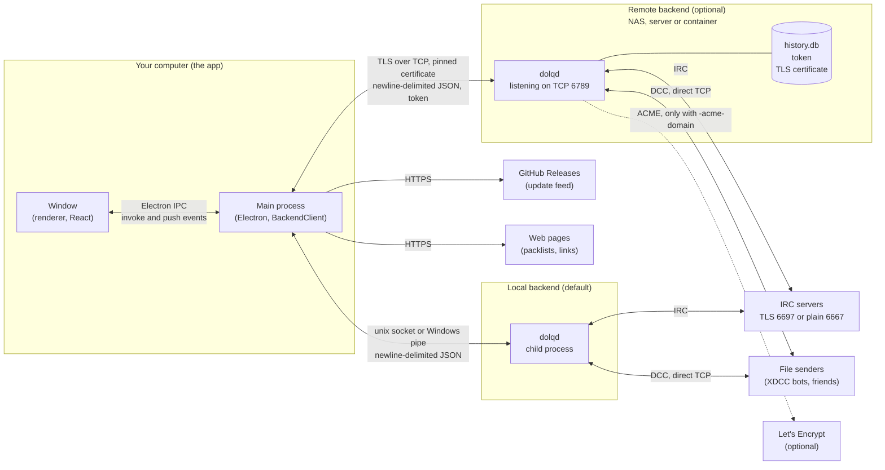

# How Dolq talks to the network

Everything Dolq sends or receives over a network, drawn as sequence diagrams and explained step by step.
The diagrams are [Mermaid](https://mermaid.js.org/), which GitHub draws in the page; in an editor, a Mermaid
preview does the same.

| Read this | When you want to know |
|---|---|
| [Local backend](local-backend.md) | How the app starts its own `dolqd` and talks to it over a private socket |
| [Remote backend](remote-backend.md) | Pairing, TLS pinning, sign-in, the heartbeat, reconnecting, switching backends while running |
| [Wire protocol](wire-protocol.md) | The frames the app and `dolqd` exchange, ordering, and how several clients share one backend |
| [IRC connection](irc-connection.md) | Connecting to an IRC server: the handshake, SASL, keep-alive, latency, reconnecting, rejoining |
| [Messages and history](messages-and-history.md) | Sending and receiving chat, what is stored, loading history, catching up after a gap |
| [File transfers](file-transfers.md) | DCC chat, XDCC downloads (including resume and pause) and sending a file |
| [App and internet](app-and-internet.md) | Update checks, links, packlist pages, `irc://` links |
| [Container and pairing](container-and-pairing.md) | Running `dolqd` in Docker or on a NAS: ports, host networking, the pairing link, Let's Encrypt |

## The big picture

Only one backend is in use at a time. The window never talks to the network itself: it asks the main process, which
asks `dolqd`. The one exception is opening a link in the user's browser, which goes through the operating system.

## Who is who

| Name | What it is | Code |
|---|---|---|
| **Window** | The React interface. Knows nothing about sockets. | `src/renderer/src/App.tsx` |
| **Preload** | The narrow bridge the window may call (`window.irc.*`). | `src/preload/index.ts` |
| **Main** | The Electron main process. Owns the backend connection, the settings and the OS keychain. | `src/main/index.ts` |
| **BackendClient** | Main's connection to a backend: requests, push frames, state, heartbeat, redial. | `src/main/irc/BackendClient.ts` |
| **dolqd** | The backend. Keeps IRC sessions and history alive whether or not an app is attached. | `backend/cmd/dolqd` |
| **ipcproto** | The server side of the wire protocol inside `dolqd`: listener, TLS, token, frames. | `backend/internal/ipcproto` |
| **bouncer** | Inside `dolqd`: the IRC sessions, who is attached to them, history, transfers. | `backend/internal/bouncer` |
| **ircclient** | One IRC connection: handshake, keep-alive, parsing. | `backend/internal/ircclient` |
| **dcc** | Direct connections to other users: chat and file transfer. | `backend/internal/dcc` |

## Ports and protocols

| Link | Transport | Default port | Encrypted | Authenticated |
|---|---|---|---|---|
| Main to local `dolqd` | Unix socket (Windows: named pipe) | none | no need: only this user can reach it | per-launch random token |
| Main to remote `dolqd` | TCP, TLS 1.2 or newer | 6789 | yes, certificate pinned by fingerprint | access token |
| `dolqd` to an IRC server | TCP, TLS optional | 6697 (TLS) or 6667 | per server setting | nick, optional server password, optional SASL PLAIN |
| `dolqd` to a file sender | TCP, plain | chosen by the OS, or a range from Preferences | no (DCC has no encryption) | none |
| Main to GitHub Releases | HTTPS | 443 | yes | none |
| `dolqd` to Let's Encrypt | HTTPS, plus TLS-ALPN-01 on your listener | 443 | yes | domain validation |

## Reading the diagrams

- A solid arrow (`->>`) is a request or a call. A dashed arrow (`-->>`) is a reply or something pushed without being
  asked for.
- Boxes labelled `loop`, `alt` and `opt` are repetition, alternatives and optional steps.
- Notes carry timings and the reason behind a step.
- Every document ends with the failure cases and where the code is.
