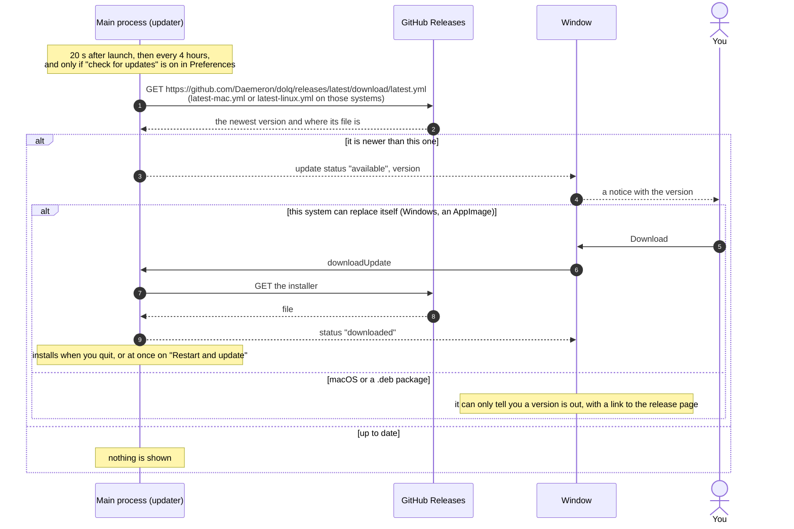
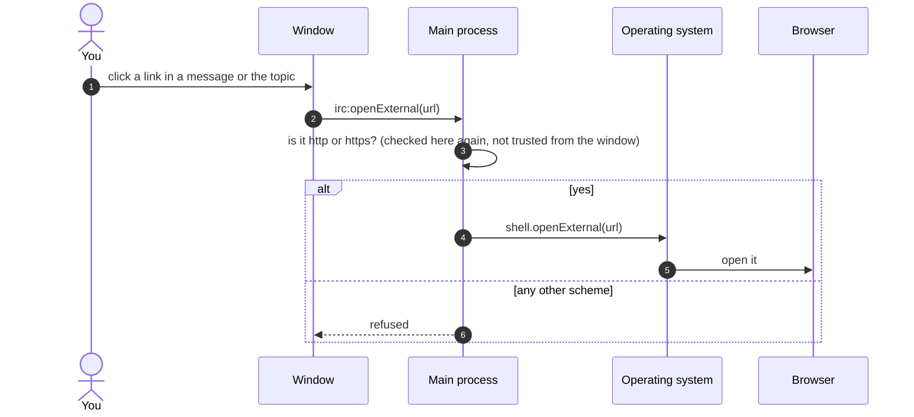
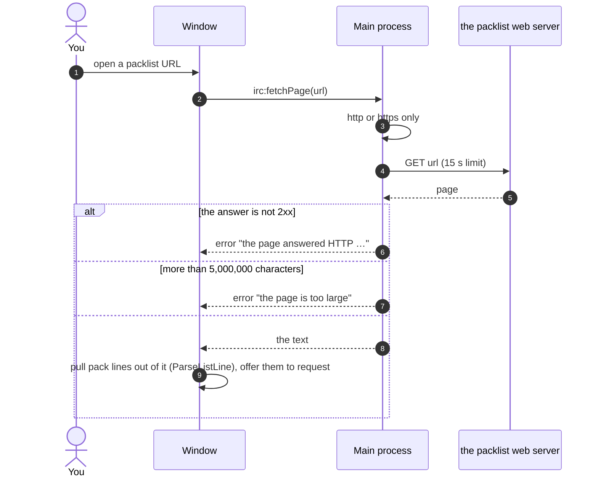
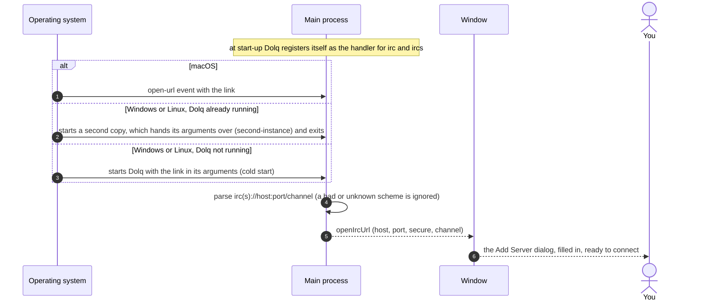

# App and internet

Apart from the backend, the app reaches the internet in exactly three ways: it **checks for updates**, it **fetches a
web page when you ask** (a packlist), and it **opens a link in your browser**. It also **receives** `irc://` links from
the operating system. Nothing else: there is no analytics or telemetry call anywhere in the source.

The window is not allowed to reach out by itself. Its content security policy is `default-src 'self'`, so it cannot
fetch from another origin. Anything on the internet goes through the main process, where it can be limited.

## Checking for updates

### Notes

1. **The feed is the latest release's own files.** No update server exists: the release workflow uploads `latest.yml`
   and friends next to the installers, and `latest/download` always points at the newest release. Publishing a
   release is what publishes the update.
2. **Nothing downloads on its own** unless you switched on "download updates automatically". A failed download goes
   back to being offered.
3. **No signing.** On macOS the app is not signed, so it cannot replace itself there; it only announces the release.
4. The check is the only request the app makes without you doing something, and it sends nothing about you beyond what
   an HTTPS request to GitHub contains.

## Opening a link

## Fetching a packlist

An XDCC bot's packlist is often a web page. The window cannot fetch it, so the main process does, for that one request.

The whole body is read before the size check, which is a known shortcut: a huge page costs memory before it is refused.

## `irc://` links from outside

Clicking an `irc://` or `ircs://` link in a browser should open Dolq on that server and channel. This is the only inbound
path the operating system has into the app.

The link only **fills in a form**. It never connects by itself, so a link on a web page cannot make Dolq join a server.

## Code

- `src/main/updater.ts`, `src/main/index.ts` (`registerUpdateHandlers`), `electron-builder.json5` (the feed URL)
- `src/main/index.ts`: `irc:openExternal`, `irc:fetchPage`, `handleIrcUrl`, `second-instance`, `open-url`
- `src/main/ircUrl.ts`: link parsing
- `src/renderer/index.html`: the content security policy
