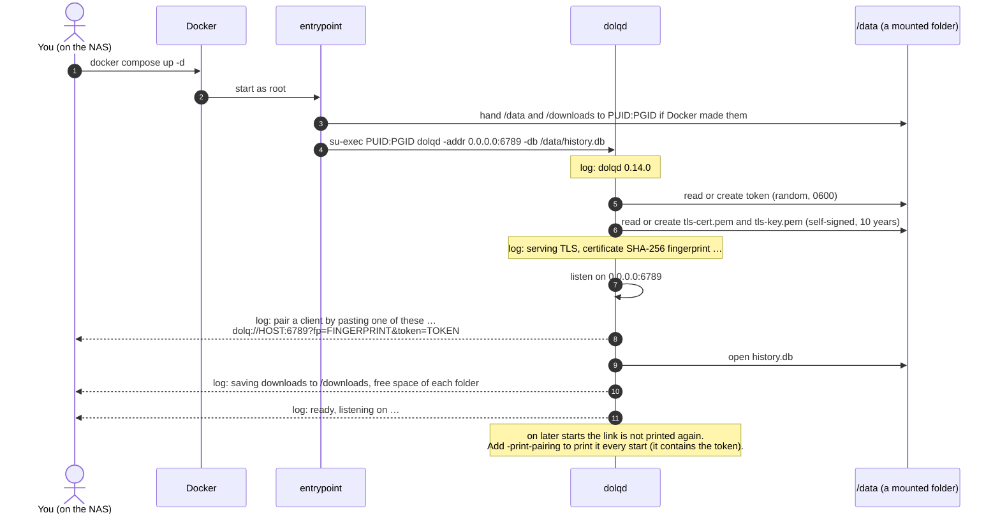
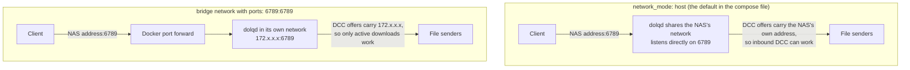
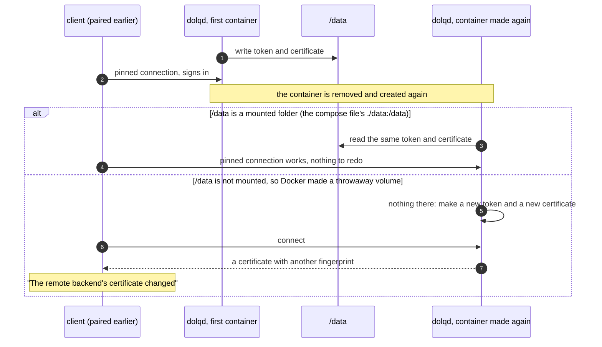
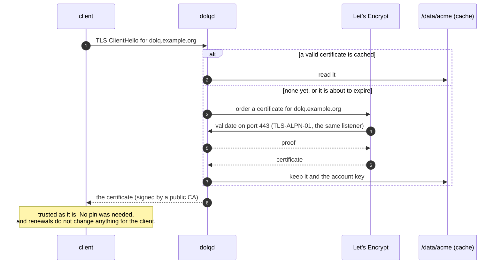

# Container and pairing

Running `dolqd` in Docker, on a NAS or on a server: how it starts, what it listens on, what it prints so a client can
pair with it, and how its certificate and token survive (or do not survive) a restart.

The compose file with every setting and its explanation is `docker-compose.release.yml` in the repository root.

## First start of a fresh data folder

### Where the host in the link comes from

The link names an address that the **client** has to be able to reach, and `dolqd` has to guess it:

1. the `-acme-domain`, if one is set (the only name its certificate is valid for), else
2. `DOLQ_PUBLIC_HOST`, if set (and `DOLQ_PUBLIC_PORT` for the port), else
3. the addresses of the machine's network interfaces.

Inside a container on a bridge network the third option finds only the container's internal address (`172.x.x.x`),
which the outside cannot reach. Set `DOLQ_PUBLIC_HOST` to the NAS's name or address, or put `network_mode: host` in
the compose file. A link with the wrong host can be fixed by hand: only the host part is wrong, the fingerprint and token
are still right.

## What the container listens on

| | Host networking | Bridge with `ports:` |
|---|---|---|
| Pairing link host | the NAS's real addresses, found automatically | needs `DOLQ_PUBLIC_HOST` |
| Port 6789 | taken on the NAS itself, must be free | mapped, can be another number (then set `DOLQ_PUBLIC_PORT`) |
| Active XDCC downloads | work | work |
| Passive XDCC, DCC chat, sending files | work on the LAN. From the internet they also need `DOLQ_DCC_HOST` and a forwarded `DOLQ_DCC_PORTS` range, or `DOLQ_DCC_HOST=auto` with UPnP on the router | work only with `DOLQ_DCC_HOST` and `DOLQ_DCC_PORTS` set, forwarded on the router and published under `ports`. Otherwise the announced address is the container's own (see [File transfers](file-transfers.md#letting-a-peer-connect-in-passive-offers-chats-files-you-send)) |
| Docker Desktop on a Mac or PC | not available | use this |

## Certificate, token and why they must persist

The certificate and the token live in the data folder (`/data` in the container). They are what a paired client holds on to.

If you see the app say the certificate changed right after re-creating a container, the usual cause is a `/data` that
is not mounted: the image declares `/data` as a volume, so without a mount Docker silently gives it a new anonymous
one each time. The log shows a new fingerprint at each start. History is lost the same way.

## Let's Encrypt instead of a self-signed certificate

With `-acme-domain`, `dolqd` gets a certificate from Let's Encrypt, so clients trust it without a pin and it renews on its
own. Validation happens on the same listener (TLS-ALPN-01), so port 443 of the domain must reach it.

`-acme-staging` uses Let's Encrypt's test service (certificates nobody trusts) for trying the setup without rate limits.
The pairing link then names the domain and carries no fingerprint.

## Older clients and plain connections

A client from before access tokens existed speaks the plain protocol without a token. `dolqd` refuses that by default.
`-allow-legacy-plain` (or `DOLQ_ALLOW_LEGACY_PLAIN=1`) makes it accept plain connections next to TLS ones on the same
port, by looking at the first byte (a TLS handshake starts with 0x16). Anyone who can reach the port can then use the
backend, so it is meant for a short migration and cannot be combined with `-tls=false` or `-token=false`.

## What the log tells you

| Log line | Means |
|---|---|
| `dolqd 0.14.0` | which version is running |
| `serving TLS, certificate SHA-256 fingerprint: …` | a self-signed certificate, and its pin |
| `warning: /data belongs to user …` | the data folder is owned by someone `PUID` cannot write as |
| `data folder /data: … free of …` | free space, with a warning when low or when it is not a mounted volume |
| `ready, listening on …` | it started |
| `client ADDR: connected` then `authenticated` | an app paired and signed in |
| `client ADDR: rejected, the access token is missing or wrong` | a client has an old or wrong token |
| `client ADDR: closed without authenticating` | a probe or port scan, or a client that gave up |
| `irc host:port: connecting as …`, `registered as …`, `joined …` | what the sessions are doing |

## Code

- `backend/cmd/dolqd/plan.go`: how the options and environment become a listening plan
- `backend/cmd/dolqd/main.go`: start-up order, `logPairing`
- `backend/internal/ipcproto/pairing.go`: the token file and the link
- `backend/internal/ipcproto/tls.go`, `acme.go`, `sniff.go`
- `backend/docker-entrypoint.sh`, `backend/Dockerfile`, `docker-compose.release.yml`
