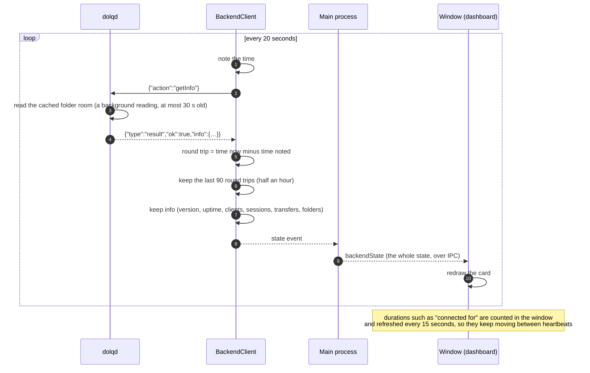
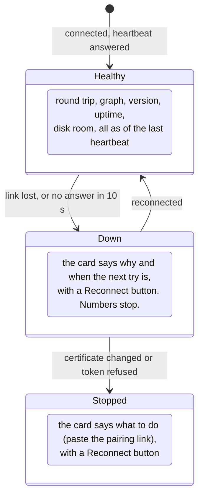

# Dashboard monitoring

When the app uses a remote backend, the dashboard has a **Remote backend** card. It answers two questions: is the link
healthy, and is the backend itself healthy (is it running out of disk, is it busy)?

Every number on the card comes from the 20-second heartbeat described in [Remote backend](remote-backend.md). Nothing
extra is sent: the heartbeat is the `getInfo` request, and the app both times it and reads its answer.

## Where each number comes from

## What the card shows

| On the card | Source | Notes |
|---|---|---|
| Status word and dot | the link's state | `Connected`, `Connecting…`, `Reconnecting…`, `Not connected` |
| Big number, in ms | the latest heartbeat round trip | green under 150 ms, amber under 400 ms, red above (the same scale as the IRC servers' latency) |
| Line graph, min, avg, max | the last 90 round trips | scaled to a span of at least 50 ms, so a steady 11 to 12 ms does not look like a mountain range |
| **Connected for** | the time the link last came up | starts again after each drop |
| **Dropped** | times the link was lost and made again | pressing Reconnect keeps the count, choosing another backend starts it over |
| **Version** | the backend's `version` | |
| **Running for** | the backend's `uptimeMs` | a duration from the backend, so the two machines' clocks do not need to agree. As old as the last heartbeat |
| **IRC connections** | `sessions` | |
| **Apps attached** | `clients` | includes this app |
| **Transfers** | `transfers` | open file transfers and direct chats |
| Disk room | `folders` | one bar per folder: free of total, how full it is |
| The last four log lines | the connection log | the full log is in the panel behind the button at the bottom of the server list |

### Disk room colours

| Colour | When |
|---|---|
| green | enough room |
| amber | less than 10% of the disk is free |
| red | less than 1 GB is free (the backend itself warns at that point, and refuses a download that would leave under 100 MB) |

Sizes are written in units of 1000, the way a disk and the backend's own log write them, so the card and
`docker logs` agree on "3.7 TB free of 6.5 TB".

## When the link is down

While the link is down the round-trip figures are hidden (they would be stale), "Connected for" shows a dash, and the
card shows the sentence from the connection state and a Reconnect button.

## A backend that is too old

A backend from before `getInfo` existed answers the heartbeat with `ok: false` and `unknown action: getInfo`. That still
proves it is alive, so the link, the round trip and the drop count all work. The card leaves out version, uptime,
sessions and disk room, and says that the backend is older than the monitoring and should be updated to show them.

## Which backends get a card

| Backend | Card |
|---|---|
| Remote | always |
| Local, running | none, there is nothing to watch: it is a child process on the same machine |
| Local, not running | shown, with the reason and a Reconnect button |

## Code

- `src/main/irc/BackendClient.ts`: `startHeartbeat`, `recordHeartbeat`, `getState`
- `src/shared/backendState.ts`: the state and info types
- `src/renderer/src/components/BackendMonitor.tsx`: the card
- `src/renderer/src/components/Dashboard.tsx`: where it is placed
- `backend/internal/ipcproto/server.go`: `info`, `folderRoom`
