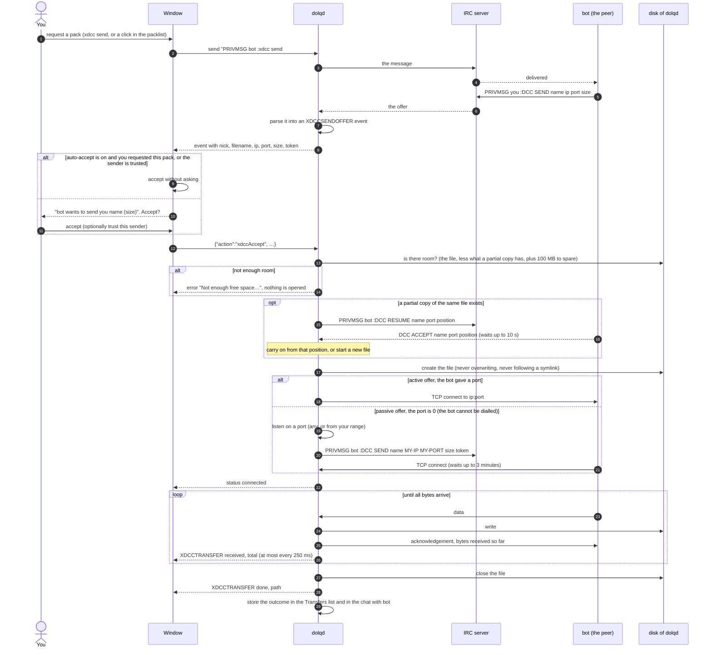
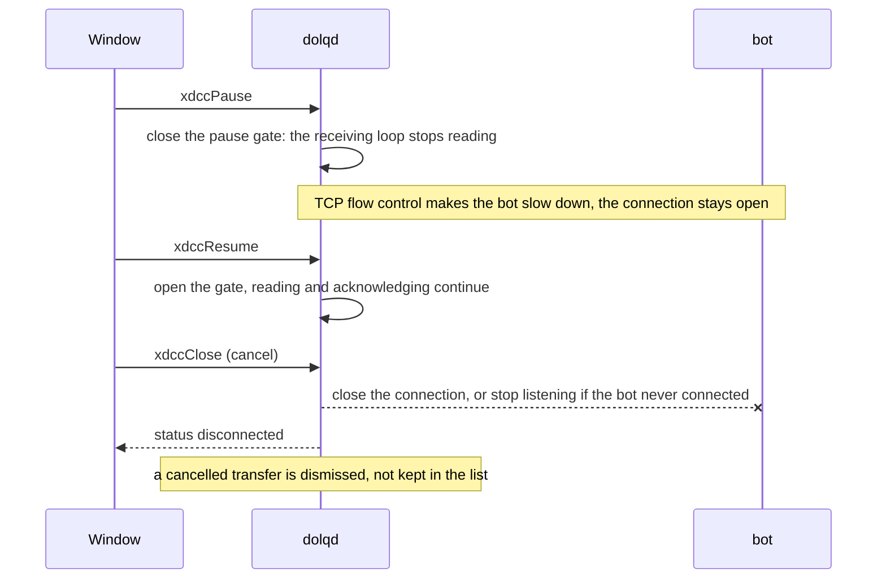
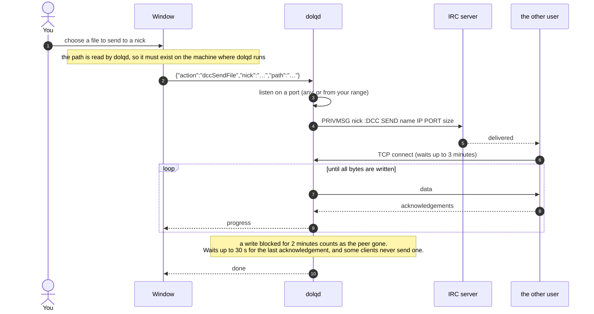
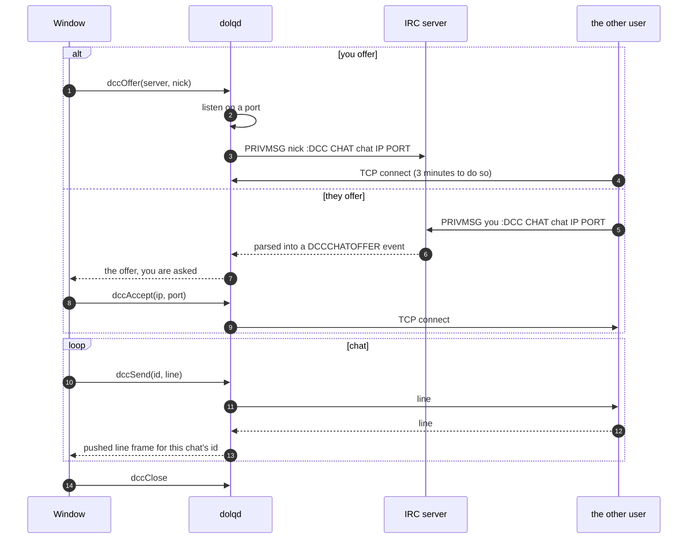
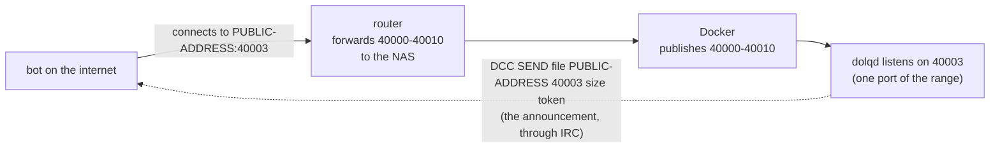
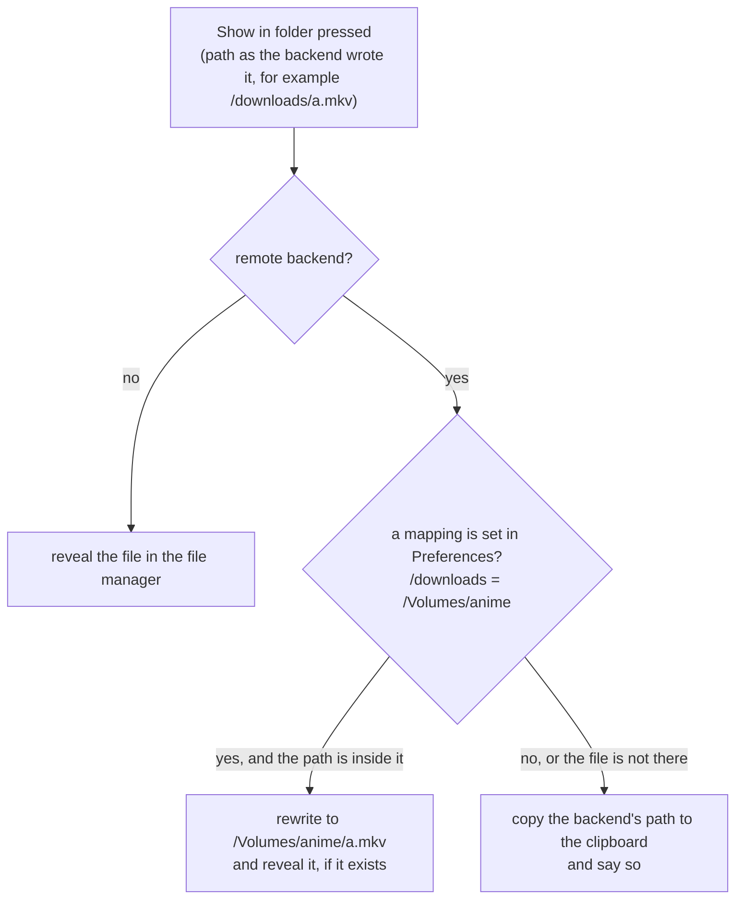

# File transfers

Files and direct chats do not go through the IRC server. IRC is only used to **arrange** them (a CTCP message saying
"connect to this address and port"); the data then flows over a direct TCP connection between `dolqd` and the other
user. `dolqd` makes those connections, not the app, so on a remote backend a download lands on the backend's disk.

## Receiving a file (XDCC)

XDCC is how bots offer files: you ask the bot for a numbered pack, and it offers the file with DCC SEND.

### Notes

1. **Who connects.** An *active* offer is the usual one: the bot has a reachable address, `dolqd` connects out. A
   *passive* offer (port 0, often with a token) means the bot cannot be reached, so `dolqd` opens a listening port
   and tells the bot where, which needs that port reachable from the bot. See the ports section below.
2. **Room check.** A download that would leave less than 100 MB free on its disk is refused with a message that names
   the folder and its free space. On a NAS the system disk is small, and filling it takes the NAS's own services with
   it. If the free space cannot be told, the download goes ahead.
3. **Safe files.** The name from the bot is cleaned (no path parts). A new file never overwrites another and does not
   follow a link planted in the folder; resuming only continues a regular file in that folder.
4. **Where it goes.** A local backend saves where Preferences say. A remote backend ignores any folder the app sends
   and saves to the folder it was started with (`DOLQ_DOWNLOAD_DIR`, `/downloads` in the compose file).
5. **Done is remembered.** Finished and failed transfers are saved by the backend, so the Transfers list is there
   after a restart and on another client. Clearing them is `deleteTransfer`.

## Pause, resume, cancel

## Sending a file

## Direct chat (DCC CHAT)

### How an address is written in a DCC message

| Form | Example | Meaning |
|---|---|---|
| A number | `3232235777` | an IPv4 address (192.168.1.1) written as one 32-bit integer, which is what the DCC convention says |
| Text with colons | `2001:db8::1` | an IPv6 address. IPv6 has no numeric form, so clients and bots write the address itself |
| Text with dots | `192.168.1.1` | an IPv4 address, accepted too |

`dolqd` reads all three. Anything else (a host name, an address with a zone such as `fe80::1%en0`, brackets) is dropped, and
the log says so (`ignored a DCC request from …`). The same goes for a subcommand it does not support, such as `SSEND` (a
TLS-encrypted send) and `TSEND`.

## Ports and networks

### IPv6

A sender offering from an IPv6 address works as an ordinary active offer: `dolqd` connects out to it. The machine `dolqd`
runs on needs IPv6 connectivity for that. A Docker bridge network has none by default, so the connection fails with
`network is unreachable` in the log. Host networking uses the NAS's own IPv6, if it has any.

What `dolqd` itself announces is still IPv4 only: the address in a passive offer, a DCC chat it offers, or a file it sends is
its IPv4 address. A peer that can only be reached over IPv6 cannot connect to those.

### Letting a peer connect in (passive offers, chats, files you send)

When the *other side* has to connect to `dolqd`, two things must be true:

1. **It is told an address it can reach.** By default `dolqd` announces its own address on the way to the internet: right on a plain LAN,
   wrong behind a router or in a container, where it is a private address nothing outside can reach. `DOLQ_DCC_HOST` (or
   `-dcc-host`) sets the address to announce: your public address, or a name that points at it (a dynamic DNS name is looked up
   at each announcement). IPv4 only.
2. **The connection can get in.** The listening port is chosen by `dolqd`, any free one by default, which cannot be forwarded.
   `DOLQ_DCC_PORTS` (or `-dcc-ports`) pins it to a range, such as `40000-40010`, or a single port. Forward the same range on the
   router to the machine, and with a Docker bridge network publish it too (the same numbers on both sides). The range set on the
   backend wins over the one in the app's Preferences, since the ports to open are the machine's to say.

At start-up `dolqd` says what it will do, and in a container with no address set it warns, because that default cannot work:
`warning: DCC: in a container, peers that have to connect here … are told the container's own address`.

An **active** offer, where the sender listens and `dolqd` connects out, needs none of this.

| Situation | Works? | Why |
|---|---|---|
| Active XDCC download | yes, anywhere | `dolqd` only connects out |
| Passive XDCC, DCC chat you offer, sending a file | needs an open inbound port | the other side connects in |
| Backend in Docker with host networking | the machine's address and ports are used | still needs the router to forward the ports, and `DOLQ_DCC_HOST` for a peer on the internet |
| Backend in Docker on a bridge network | only active downloads, unless `DOLQ_DCC_HOST` and `DOLQ_DCC_PORTS` are set and the range is published | otherwise it announces the container's internal address |
| Behind a router | set the range (the backend's `DOLQ_DCC_PORTS`, or Preferences for a local backend) and forward it | otherwise the OS picks any free port |

Preferences has a DCC port range (min and max). Leave both empty to let the operating system pick; set a range to
forward through a router or firewall.

The address `dolqd` announces in an offer is the one the operating system would use to reach the internet. It finds it
by opening a UDP socket towards 8.8.8.8, which sends nothing. That is the machine's **LAN** address, not its public
one, so a peer outside your network cannot connect to a passive offer even with the port forwarded. In a container it
is the container's own address, which is why host networking matters there.

## Showing a download on your own computer

A remote backend saves on its own disk. The Transfers list can still reveal a file in your file manager if you tell the
app how the backend's folder looks from your computer.

## Failure cases

| What happens | What you see |
|---|---|
| Not enough room | `Failed: …` naming the folder and its free space, nothing downloaded |
| The bot never connects (passive) | after 3 minutes the transfer ends as disconnected |
| The peer goes away mid-file | the transfer fails with the error, the partial file is kept and can be resumed |
| A resume is not accepted in 10 s | a new file is started instead |
| Cancel | the transfer ends and is not kept in the list |

## Code

- `backend/internal/bouncer/xdcc.go`: `XDCCAccept`, `openDestination`, `requestResume`, `runXDCCTransfer`, `checkRoom`
- `backend/internal/bouncer/dcc.go`, `dccsendfile.go`: chat and sending
- `backend/internal/dcc/`: the sockets, offer parsing, `ReceiveFile`, `SendFile`, the pause gate
- `backend/internal/ircclient/client.go`: `handleDCCRequest`
- `src/renderer/src/App.tsx`: `XDCCSENDOFFER`, `XDCCTRANSFER`, `handleShowInFolder`
- `src/shared/remotePath.ts`: the path mapping
