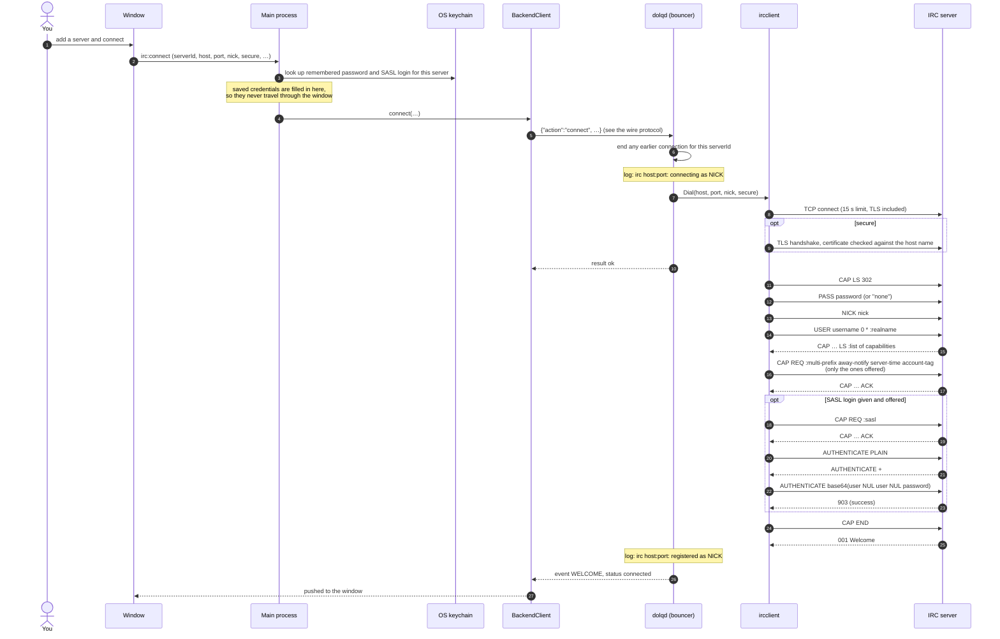
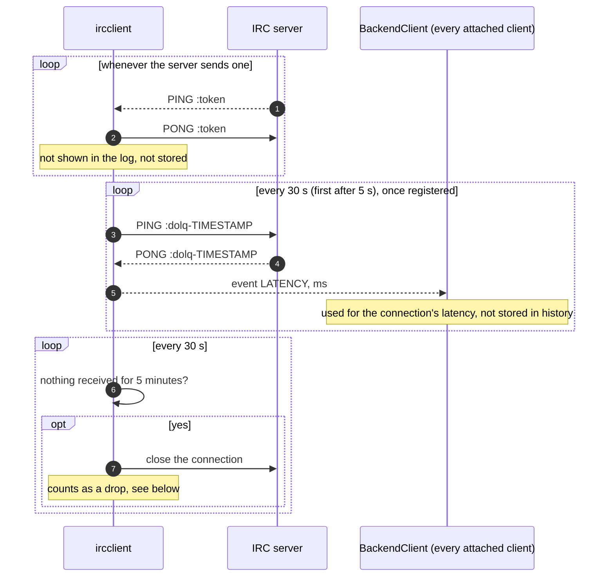
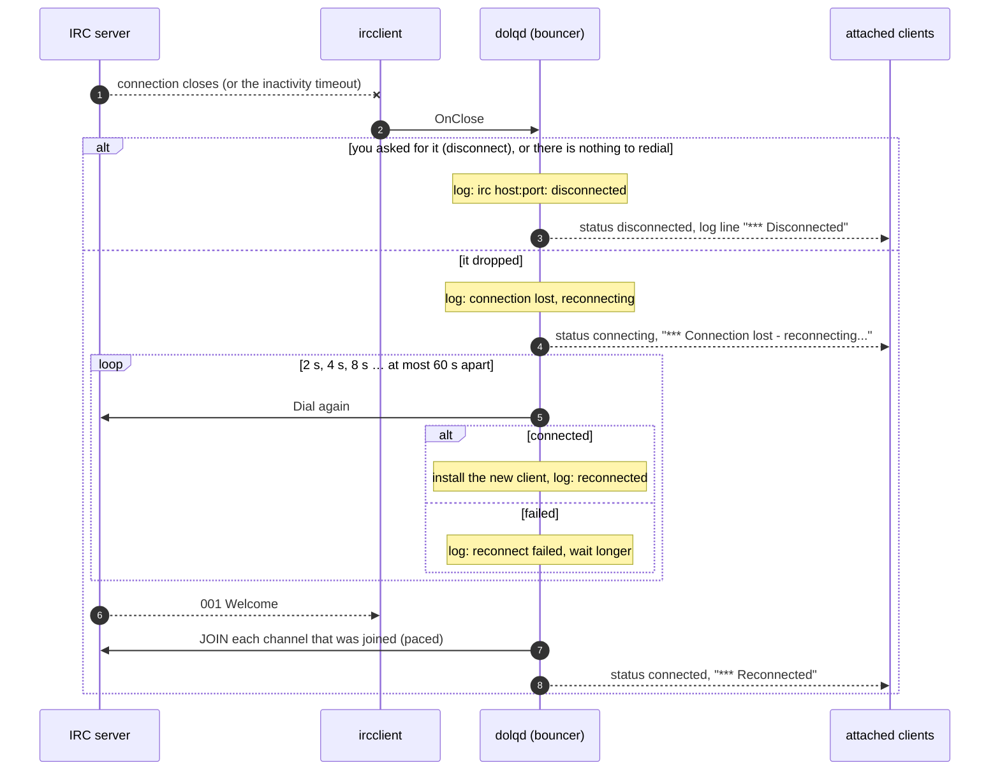
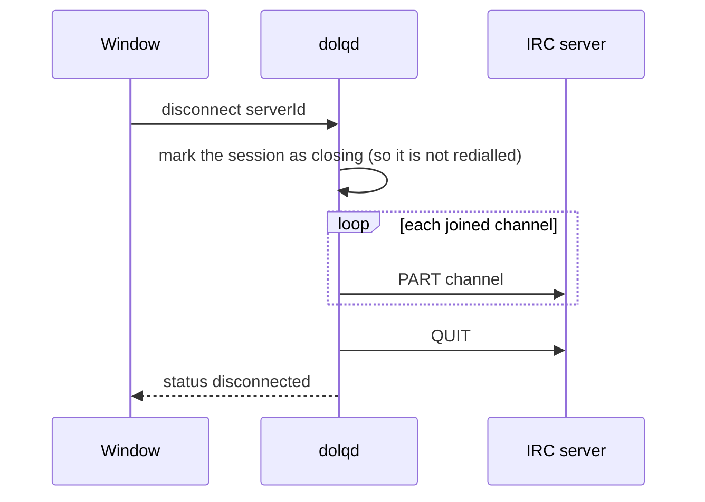

# IRC connection

`dolqd` holds the connection to each IRC server. The app only asks for it and listens. This page follows one server
from "connect" to "gone", and what happens when the network under it breaks.

## Connecting

### Notes

1. **Credentials.** A password the user chose to remember is stored in the OS keychain and added by the main process.
   The window never holds it after saving.
2. **The result comes early.** `connect` answers once the TCP and TLS connection is up. Registration (001) arrives
   later as a pushed event, because a server can take its time (some wait for ident or DNS).
3. **Capabilities.** Dolq asks for `multi-prefix`, `away-notify`, `server-time` and `account-tag`, and only the ones
   the server offered. If the server never answers `CAP LS` within 10 seconds, it goes on without any (log: `CAP: timed
   out waiting for the server's capability list`). A slow server such as one that makes you wait for DNS shows up
   this way.
4. **SASL is optional.** If login fails the connection continues without it (logged), because a working connection
   with a different nick is better than none.
5. **Nick in use.** While not yet registered, the client tries the alternative nicks from the server's settings in
   order, then your nick with underscores added (`nick_`, `nick__`), at least five times, before giving up.
6. **TLS certificates.** A secure IRC connection uses normal certificate checking against the server's name. It is
   not pinned, unlike the link to a remote backend.

## Staying connected

Anything the server sends resets the five minute inactivity clock. Lines going out are paced (a burst of 4, then one
every 2 s), including the ones you type, so joining many channels or pasting a lot of text does not get you kicked for
flooding. Only the handshake and the replies to the server's pings skip the pacing.

## When the connection drops

The channels to rejoin are the ones joined when the connection broke. A connection that dropped before its welcome
keeps the list from before it, so a flapping connection does not forget where you were.

## Leaving on purpose

When `dolqd` itself shuts down it does this for every session first, so other users see you leave cleanly.

## Failure cases

| What happens | What the log (and window) show |
|---|---|
| The server refuses or does not answer | `irc host:port: could not connect: …`, the connect fails |
| The server drops you | `connection lost, reconnecting`, then `reconnected` |
| The server is silent for 5 minutes | the same |
| Slow or missing capability list | `CAP: timed out waiting for …`, registration continues |
| SASL failed | `SASL: authentication failed (…) - continuing without it` |
| Nick taken | an alternative nick, shown in the registered line |

## Code

- `backend/internal/bouncer/bouncer.go`: `Connect`, `wire`, `handleClose`, `reconnect`, `Disconnect`
- `backend/internal/ircclient/client.go`: `Dial`, `handshake`, `negotiateCaps`, `negotiateSASL`,
  `watchPingTimeout`, `measureLatency`
- `src/main/index.ts`: the `irc:connect` handler and `withSavedSecrets`
