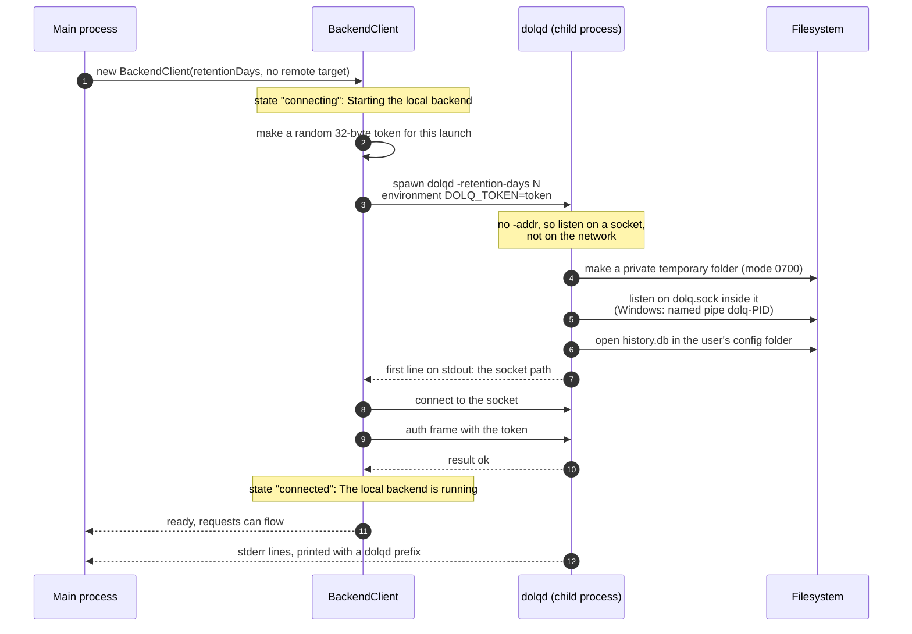
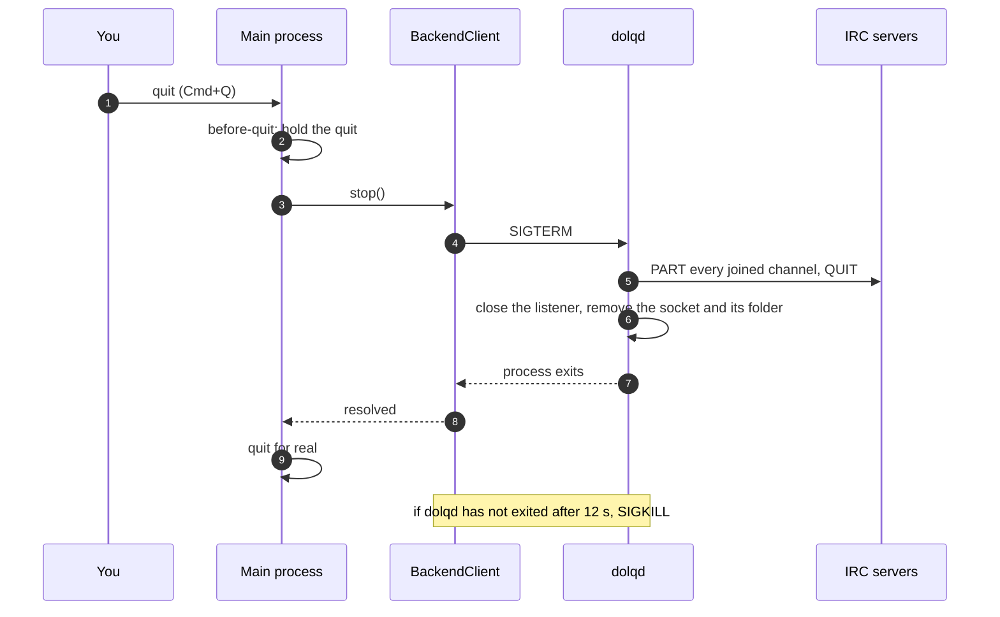
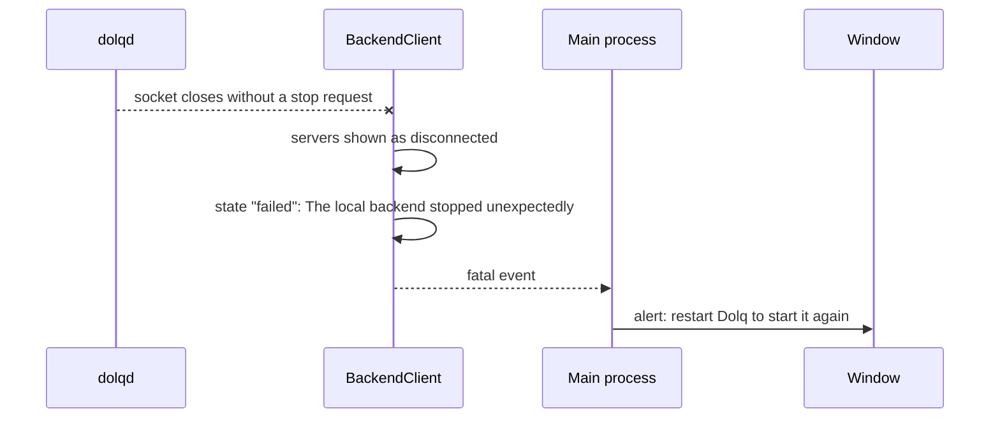

# Local backend

By default the app runs its own `dolqd` as a child process and talks to it over a private socket. Nothing here
touches the network: it is how the app and its backend find each other on one machine.

## Start-up

### Notes

1. **Why a token on a private socket.** The folder holding the socket is private, but the token is a second lock: only
   this process and the child it started know it, so nothing else running as the same user can use the socket even if
   its permissions were wrong.
2. **Why stdout.** The path of the socket is the one thing the child prints on stdout, as a bare line. The app reads
   exactly that line to find it, so the socket path never has to be agreed in advance.
3. **Windows.** Node cannot connect to an `AF_UNIX` socket on Windows (it fails with `EACCES`), so `dolqd` listens on a
   named pipe called `dolq-<pid>` instead. The rest is identical.
4. **Where history lives.** `history.db` is under the operating system's per-user config folder (for example
   `~/Library/Application Support/dolq` on a Mac), created owner-only. It is the only thing that survives a restart.
5. **Development.** A build from source compiles `dolqd` with `go build` into a temporary file first, and removes it
   on exit. A packaged app runs the `dolqd` shipped inside it.

## Shutting down

`dolqd` gets up to 10 seconds to say goodbye to the IRC servers; the app waits 12 before it gives up and kills it.

## If the local backend dies

A local backend is never restarted by the app on its own: it only dies on a crash, and a crash is worth a message. A
remote backend is different: it is redialled forever (see [Remote backend](remote-backend.md)).

## Failure cases

| What happens | What you see |
|---|---|
| The `dolqd` binary is missing or cannot start | A "Dolq backend" alert with the reason, state `failed` |
| `dolqd` exits before printing the socket path | The same, with its exit code |
| `dolqd` crashes while running | An alert, servers show disconnected, the button at the bottom of the server list turns red |

## Code

- `src/main/irc/BackendClient.ts`: `spawnAndDial`, `lost`, `stop`
- `src/main/irc/stopChild.ts`: the 12 second grace period
- `backend/cmd/dolqd/plan.go`: why no `-addr` means a socket, and where a token is required
- `backend/cmd/dolqd/main.go`: the private socket folder, printing the path, shutdown
