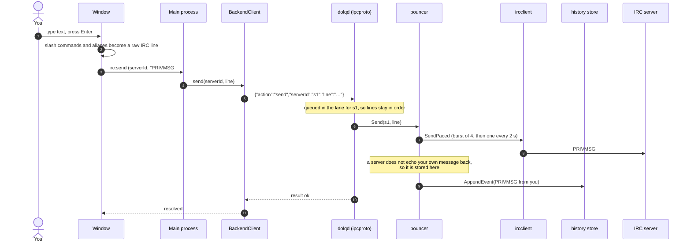
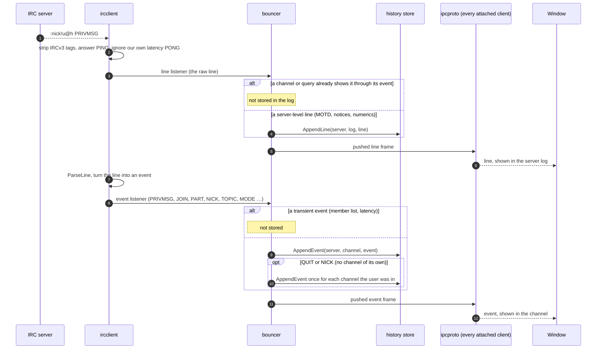
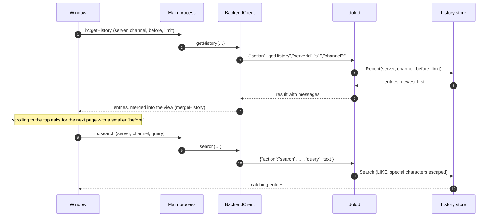
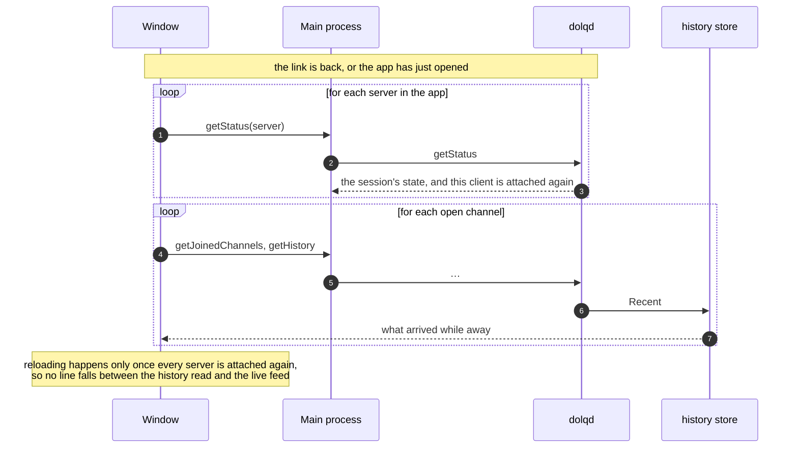

# Messages and history

How a line you type reaches the server, how what the server says reaches your screen, and how it ends up stored so a
window opened later (or a second client) can show it.

## Sending a message

### Notes

1. **What is kept out of history.** A message to a services account (a nick ending in `serv`, or a user@host) that
   starts with `identify`, `login`, `auth`, `register`, `group`, `ghost`, `release` or `recover` is sent but never
   stored, because it holds a password in plain text.
2. **Only chat is stored on the way out.** Lines that are not a chat message (JOIN, MODE, PING, …) are sent and not
   recorded; what the server says about them comes back as events.
3. **Order.** Because `send` frames for one server share a queue, what you type first goes out first even when the
   backend is busy with other requests.

## Receiving

### Notes

1. **Two views of the same traffic.** The raw line feeds the server log; the parsed event feeds channels and private
   chats. That is why WHOIS replies can be hidden from the log view while still being stored.
2. **Stored once, shown everywhere.** Storage happens in `dolqd` before anything is sent to a client, so a client that
   is attached, one that attaches later, and one that never existed all read the same history.
3. **Writing is queued.** Appends go into a queue and are written to SQLite in batches by one goroutine, so a slow
   disk never stalls an IRC session. If the disk cannot be written (full, read-only), the failures are counted and
   reported in the log at most every so often, and the batch is dropped rather than retried forever.

## Loading history and searching

History is per server and per channel (a private chat is a channel named after the other person). A server's raw lines
live in a channel of their own, the log.

## Catching up after a gap

When the app was not attached (closed, asleep, or its link to the backend dropped), `dolqd` kept the IRC sessions
going and stored everything. Attaching again is therefore a read, not a replay:

## Retention

`dolqd -retention-days N` (Preferences on a local backend, the compose file or command line for a remote one) removes
history older than N days; 0 keeps it forever. Pruning runs in the background. A local backend reads this setting
when it starts, so changing it needs a restart of the app; a remote backend reads its own.

## Code

- `backend/internal/bouncer/bouncer.go`: `Send`, `wire`, `channelScopedLine`, `outgoingEvent`
- `backend/internal/history/history.go`: the store: queue, batches, `Recent`, `Search`, pruning
- `src/renderer/src/App.tsx`: the event switch, `reconcile`, history paging
- `src/renderer/src/utils/mergeHistory.ts`, `whoisFilter.ts`, `logLine.ts`
