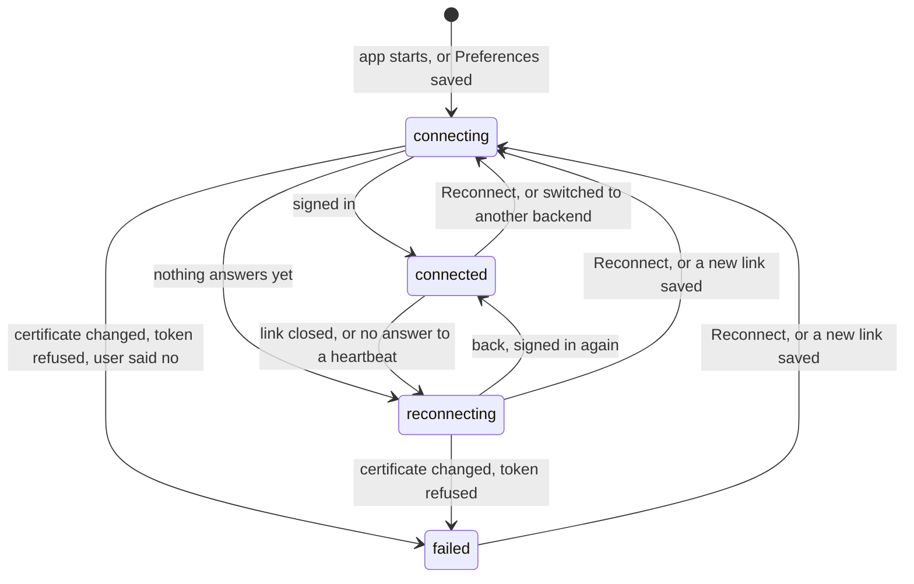
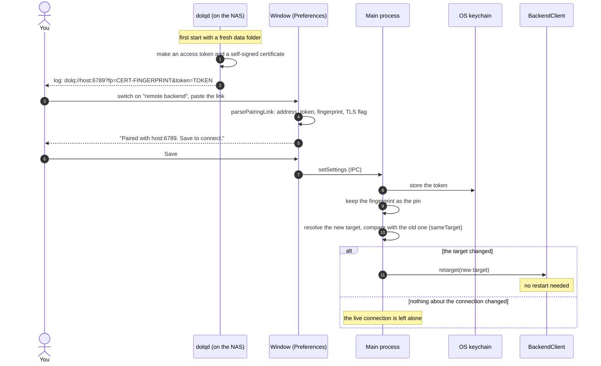
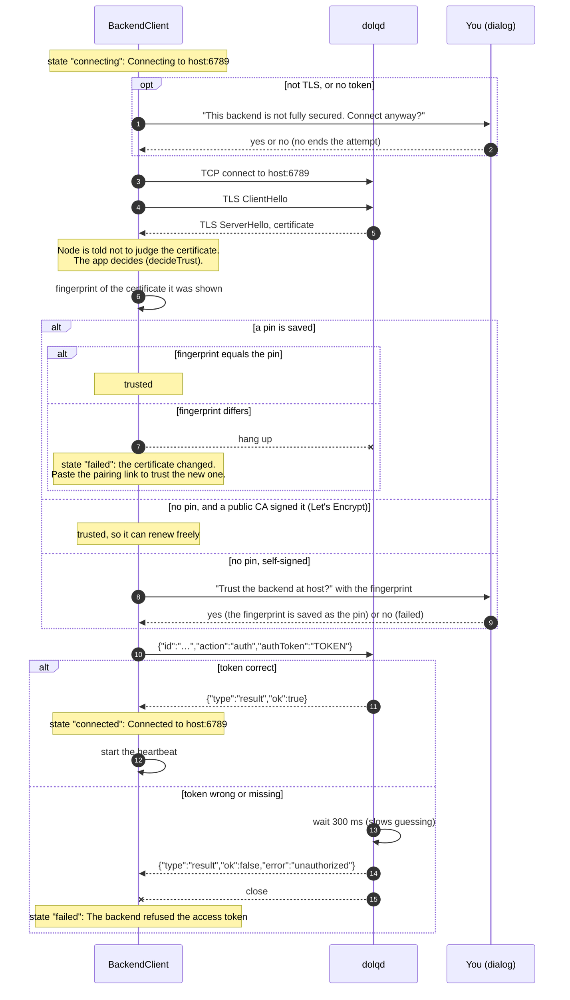
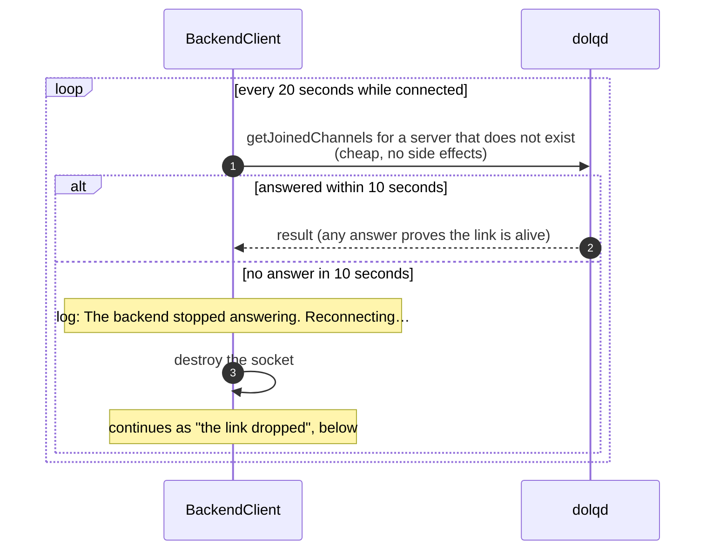
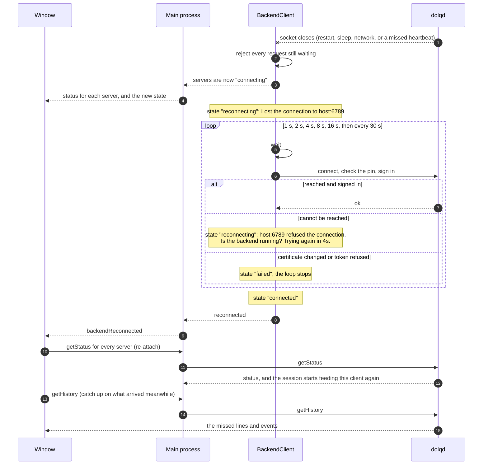
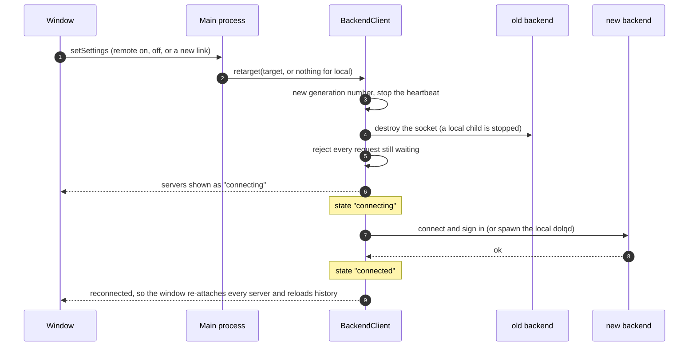
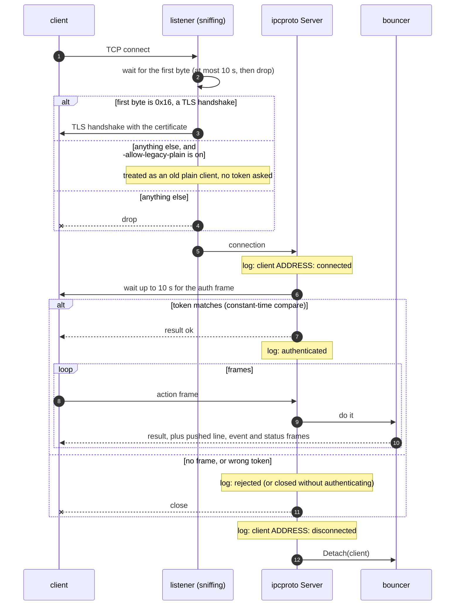

# Remote backend

A `dolqd` that runs on another machine (a NAS, a server, a container) keeps your IRC sessions and history alive while
the app is closed. The app attaches to it over TLS. This page covers pairing, how the connection is secured, how the
app keeps it alive, and how it switches between backends while running.

How `dolqd` itself is deployed (Docker, ports, the pairing link) is in [Container and pairing](container-and-pairing.md).

## The states

The app always knows how the link is doing, and says so in the button at the bottom of the server list.

| State | Meaning | Does the app keep trying? |
|---|---|---|
| `connecting` | Dialling for the first time, or starting over | yes |
| `connected` | Signed in. The heartbeat runs | not needed |
| `reconnecting` | The backend cannot be reached or the link dropped. The panel says why and when the next try is | yes, forever, with growing waits |
| `failed` | Something retrying cannot fix: a changed certificate or a refused token | no, until you act |

## Setting it up once

### Notes

1. **The link carries everything.** Address, access token and the certificate's fingerprint travel together, out of
   band, in one paste. Because the fingerprint arrives with the token, there is nothing to confirm on first connect.
2. **The token never reaches the window.** After pasting, the window sends it once to the main process, which keeps it
   in the OS keychain (or an owner-only file where there is none). The window only learns whether one is saved.
3. **A pin belongs to one address.** Saving a different address without a new link drops the old fingerprint and
   token, so a secret cannot follow you to another host.
4. **Validation.** A link without a token, with a bad port, or with a malformed fingerprint is refused in the window
   ("That is not a valid Dolq pairing link") and never saved. A fingerprint that could not match would only fail
   later, confusingly.

## Connecting: certificate pinning, then sign-in

### Notes

1. **Why the app judges the certificate itself.** A pinned fingerprint must match even if a public CA signed the
   certificate. Otherwise anyone who could get a trusted certificate for that name could stand in for a self-signed
   backend you paired with. Without a pin, a public CA's certificate is accepted as it is, and a self-signed one is
   shown to you once.
2. **Not fully secured.** `dolqd` can be run with `-tls=false` and/or `-token=false` for a tunnel or a proxy you
   trust. The app agrees to talk like that only after you say yes, and loopback addresses never ask.
3. **Timeouts on the server.** A connection that stays silent for 10 seconds is dropped (see
   [How `dolqd` takes a connection](#how-dolqd-takes-a-connection)). The auth frame must arrive within 10 seconds.

## Keeping the link alive

TCP keepalive is on (30 s), but an operating system can take minutes to notice a dead link after a sleep, a NAT
timeout or a NAS reboot. So the app checks for itself.

## When the link drops

### Notes

1. **IRC does not notice.** The IRC sessions live in `dolqd`, which keeps running. While the app was away it kept
   the sessions up, kept answering IRC pings and stored everything. That is why catching up is only a history read.
2. **A failed state is not a loop.** A changed certificate or a refused token is something retrying cannot fix, so the
   app stops, says what it is, and waits for you (Reconnect, or a new link).
3. **Error wording.** Network errors are turned into sentences with a next step: `ECONNREFUSED` says nothing is
   listening, `ETIMEDOUT` suggests a firewall or a machine that is off, `EHOSTUNREACH` also mentions the Mac's Local
   Network permission, `ENOTFOUND` suggests using the IP address.

## Switching backends while running

Saving Preferences, or pressing Reconnect, changes what the app is connected to with no restart. The same routine
serves both, and also switches between local and remote.

A dial that was still under way for the old target notices the generation changed after it signs in and drops its
socket, so a slow old connection can never take over from the new one.

## How `dolqd` takes a connection

- A probe or port scan that sends nothing is told apart in the log from a client with the wrong token.
- A client that stops reading is hung up on after a 10 second write timeout, because one stuck client must not stall
  an IRC session shared by others.
- When a client detaches, the IRC sessions stay up.

## Failure cases

| Cause | What the panel says | What to do |
|---|---|---|
| Wrong address or backend down | `host:port refused the connection: nothing is listening there…` | Start the backend, check the port. Retries on its own |
| Firewall or machine off | `host:port did not answer…` | Retries on its own |
| No route (a Mac without Local Network permission) | `There is no route to host:port… Local Network` | Allow Dolq in Privacy and Security, Local Network |
| Name does not resolve | `The name in host:port could not be found…` | Use the IP address |
| The backend was re-created with a new certificate | `The remote backend's certificate changed (now …)` | Paste its new pairing link |
| Token changed | `The backend refused the access token` | Paste its new pairing link |
| The link was silent for 10 s after a heartbeat | log: `The backend stopped answering. Reconnecting…` | Retries on its own |

## Code

- `src/main/irc/BackendClient.ts`: `begin`, `connectRemote`, `dialTls`, `attach`, `lost`, `ping`, `retarget`
- `src/main/remoteBackend.ts`: `decideTrust`, `insecureReasons`, `sameTarget`, `describeDialError`
- `src/main/irc/redial.ts`: the waits
- `src/shared/pairing.ts`: `parsePairingLink`
- `backend/internal/ipcproto/sniff.go`, `server.go`, `tls.go`: the listener, sign-in, the certificate
