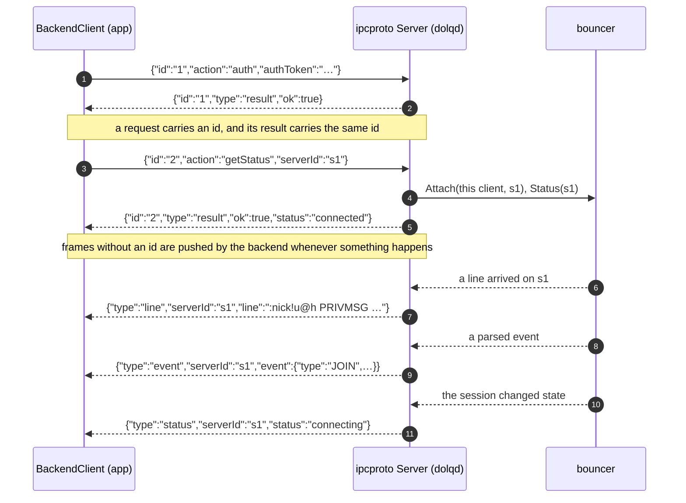
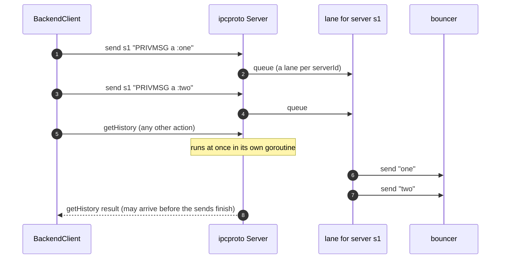
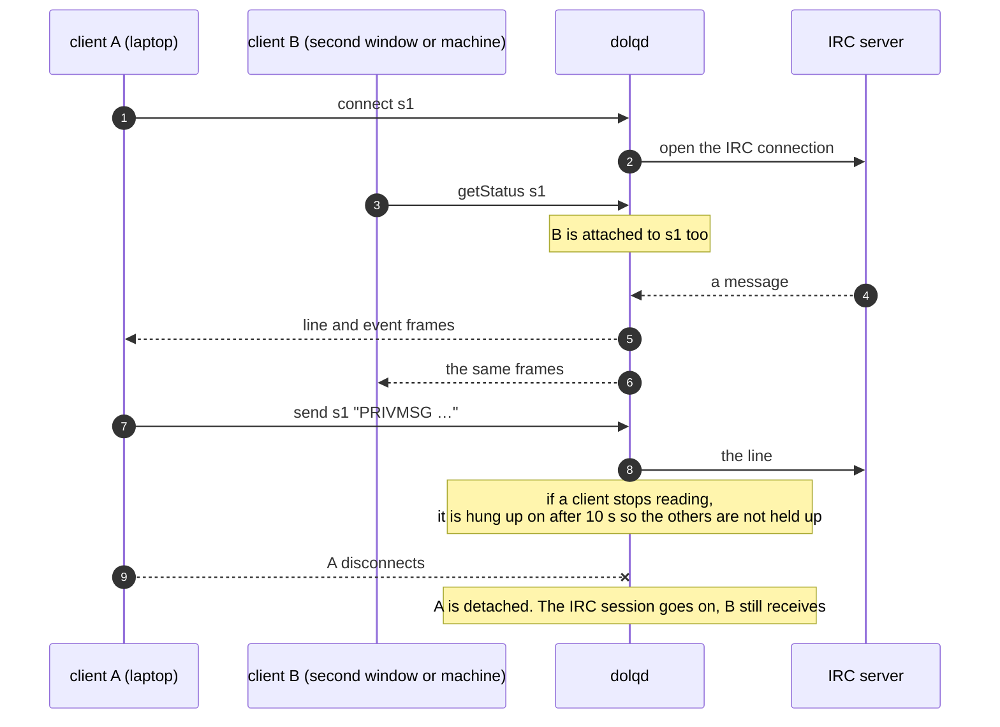

# Wire protocol

The app (through its main process) and `dolqd` exchange **newline-delimited JSON**: one JSON object per line, in
both directions. The same protocol runs over the local socket and over the remote TLS connection.

## Shape of a conversation



- **Request frames** (client to backend) have an `action`, an `id` the client makes up (a UUID), and the fields that
  action needs. Unused fields are left out.
- **Result frames** (backend to client) have `"type":"result"`, the same `id`, `ok`, and either an `error` or the
  answer (`status`, `channels`, `messages`, `transfers`, `dccId`).
- **Pushed frames** (backend to client) have no `id`: `line` (a raw IRC line), `event` (a parsed one) and `status`
  (`connected`, `connecting`, `disconnected`). They carry the `serverId` they belong to, so one subscription per
  frame type covers every server. For a file transfer or a DCC chat, `serverId` holds the transfer's id (`xdcc:…`,
  `dcc:…`).
- A frame that is not valid JSON gets an error result and the connection carries on.

## Actions

| Action | Fields it uses | Answer | What it does |
|---|---|---|---|
| `auth` | `authToken` | `ok` | Must be the first frame when the backend asks for a token. Anything else first, or a wrong token, closes the connection |
| `connect` | `serverId`, `host`, `port`, `nick`, `secure`, `saslUser`, `saslPass`, `username`, `realname`, `altNicks`, `password` | `ok` | Opens an IRC connection (closing a previous one for that `serverId`). See [IRC connection](irc-connection.md) |
| `disconnect` | `serverId` | `ok` | Quits that IRC connection for good |
| `send` | `serverId`, `line` | `ok` | Sends one raw IRC line. Strictly in order per server |
| `getStatus` | `serverId` | `status` | Says how a session is doing, **and attaches this client to it** so it receives its pushed frames |
| `getJoinedChannels` | `serverId` | `channels` | Channels the session is in. An unknown `serverId` gives an empty list |
| `getHistory` | `serverId`, `channel`, `before`, `limit` | `messages` | A page of stored lines and events, newest first |
| `search` | `serverId`, `channel`, `query`, `limit` | `messages` | Full-text search in the history |
| `dccOffer` | `serverId`, `nick`, `portMin`, `portMax` | `dccId` | Offers a DCC chat: listens, tells the peer where |
| `dccAccept` | `host`, `port` | `dccId` | Joins a chat the peer offered |
| `dccSend` | `dccId`, `line` | `ok` | Sends one chat line |
| `dccClose` | `dccId` | `ok` | Ends a chat |
| `dccSendFile` | `serverId`, `nick`, `path`, `portMin`, `portMax` | `dccId` | Offers a file on the backend's disk to a peer |
| `xdccAccept` | `serverId`, `nick`, `host`, `port`, `filename`, `size`, `token`, `destDir`, `portMin`, `portMax` | `dccId` | Takes a file a bot offered. See [File transfers](file-transfers.md) |
| `xdccClose` | `dccId` | `ok` | Cancels a transfer |
| `xdccPause`, `xdccResume` | `dccId` | `ok` | Pauses and resumes a download |
| `getInfo` | none | `info` | The backend describes itself (below). The app sends it every 20 s as its heartbeat. A backend from before it existed answers `ok: false` with `unknown action: getInfo`, which still proves it is alive |
| `getTransfers` | none | `transfers` | Transfers that ended, kept across restarts |
| `deleteTransfer` | `dccId` (empty for all) | `ok` | Forgets one saved transfer, or all |

## What `getInfo` answers

```json
{"id":"7","type":"result","ok":true,"info":{
  "version":"0.15.0",
  "uptimeMs":273600000,
  "clients":1,
  "sessions":3,
  "transfers":1,
  "folders":[
    {"name":"data","path":"/data","free":3700000000000,"total":6500000000000},
    {"name":"downloads","path":"/downloads","free":3700000000000,"total":6500000000000}
  ]}}
```

| Field | Meaning |
|---|---|
| `version` | The release this `dolqd` was built from (`dev` for a build from source) |
| `uptimeMs` | How long the process has been running. A length of time, not a start time, so a client with a different clock still shows it right |
| `clients` | Authenticated apps attached now, including the one asking |
| `sessions` | IRC connections held, including ones being redialled |
| `transfers` | Open file transfers and direct chats |
| `folders` | The folders it writes to, with free and total bytes. A folder whose size cannot be read has an `error` instead |

The free space is read in a background goroutine and kept for up to 30 seconds. Only the first ever `getInfo` waits for
a reading, for at most a second. A folder that does not answer (a stalled network share) leaves the `folders` list without
it, and never delays the answer.

## Ordering and concurrency



- `send` frames for one server go through one queue (capacity 256), so what you typed first is sent first, even though
  the server handles different requests concurrently.
- Every other action runs on its own, so a slow history query never holds up typing.
- Results can arrive in any order. That is why they carry the request's `id`.

## Several clients, one backend



A client receives pushed frames only for sessions it has attached to, which happens when it asks `getStatus` for them
(after it connects, or reconnects). `connect` attaches the client that made it.

## Security of the frames

- Over the local socket the connection is private to the user; over TCP it is inside TLS. Frames are never sent in the
  clear except in the explicitly agreed `-tls=false` setups.
- A remote backend pins where downloads go: the `destDir` an app sends in `xdccAccept` is ignored and `dolqd` saves
  to its own configured folder, so a client of a network backend cannot choose a path on the server.
- The token is compared in constant time, and a wrong one costs the guesser 300 ms.

## Code

- `backend/internal/ipcproto/frame.go`: all action and frame definitions
- `backend/internal/ipcproto/server.go`: reading, the per-server lanes, `handleFrame`
- `src/main/irc/BackendClient.ts`: `request`, `handleFrame`, the typed methods
- `src/shared/ipc.ts`: the app's own IPC names (window to main), which are separate from these frames
